<div align="center">

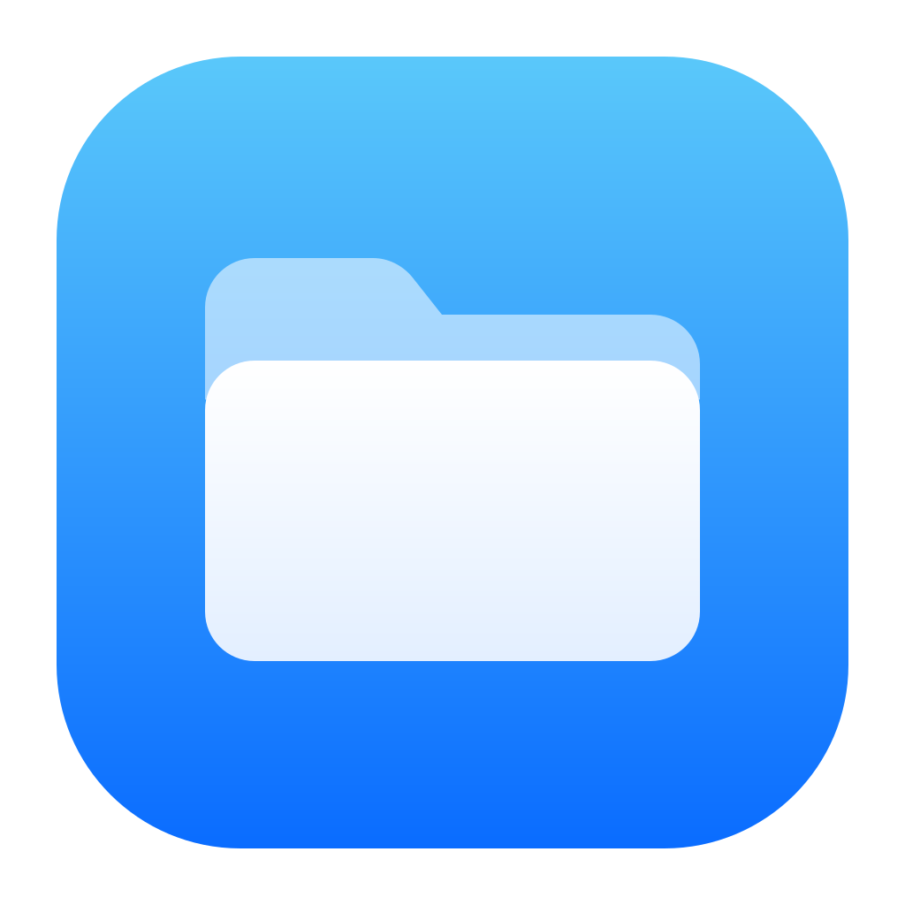

# eX-plorer

**Ein moderner Datei-Explorer für Windows 10 und 11 im Stil des macOS Finder.**
Schnell, aufgeräumt, mit Spaltenansicht, Suche in Unterordnern und echter Windows-Shell darunter.

[](https://github.com/theslasher5g/eX-plorer/actions/workflows/ci.yml)
[](https://github.com/theslasher5g/eX-plorer/releases/latest)
[](LICENSE)


[**Download**](https://github.com/theslasher5g/eX-plorer/releases/latest) ·
[Funktionen](#funktionen) ·
[Bedienung](#bedienung) ·
[Selbst bauen](#selbst-bauen) ·
[Sicherheit](#sicherheit) ·
[Handbuch](docs/HANDBUCH.md)

<picture>
  <source media="(prefers-color-scheme: dark)" srcset="docs/media/hero-dark.png">
  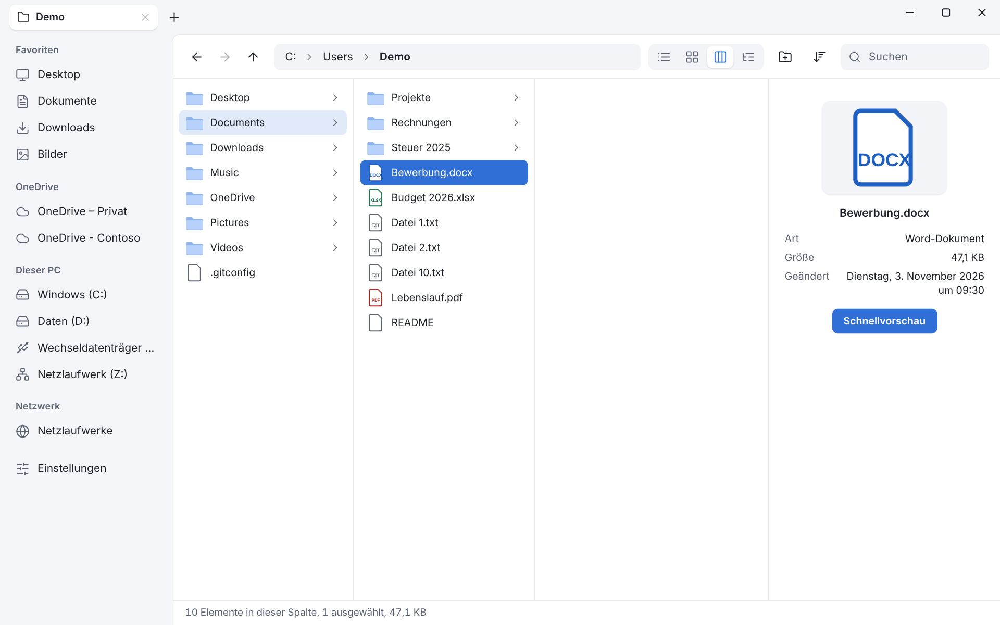
</picture>

<sub>Screenshots und GIFs stammen aus dem Demo-Modus mit erfundenen Daten.</sub>

</div>

---

> [!NOTE]
> **Frühe Version (0.1).** Vieles greift tief in Windows ein (Shell, Drag & Drop, OneDrive,
> Netzwerk) und wurde bisher nur von wenigen Personen auf echten Rechnern geprüft.
> Fehlerberichte sind willkommen. Die ehrlichen Grenzen stehen im
> [Handbuch](docs/HANDBUCH.md#bekannte-einschränkungen).

## Funktionen

<table>
<tr>
<td width="50%" valign="top">

### 🗂 Vier Ansichten
**Liste**, **Kacheln**, **Spalten** wie im Finder (mit Vorschau rechts) und eine
**Baumansicht** mit festen Obergrenzen – auch bei 100.000 Dateien flüssig, weil alles
virtualisiert ist. `Strg+1…4` wechselt.

</td>
<td width="50%" valign="top">

### 🔎 Suche, die Unterordner kennt
Tippen filtert sofort, danach wird im Hintergrund in **allen Unterordnern**
gesucht (`*` und `?` als Platzhalter). Zusätzlich springt die **Tippsuche** mit den
ersten Buchstaben zur Datei.

</td>
</tr>
<tr>
<td valign="top">

### 🖱 Wie ein Profi-Werkzeug
Auswahl per **Gummiband**, **Drag & Drop** mit Live-Markierung des Ziels,
**Gruppieren** nach Name, Typ, Datum und Größe, **Tabs**, Favoriten per Rechtsklick
anheften und per Ziehen sortieren.

</td>
<td valign="top">

### 🪟 Echte Windows-Shell
Kopieren, Verschieben und Löschen laufen über `IFileOperation` (Papierkorb,
Konfliktdialoge). Das **Kontextmenü** kommt von Windows – 7-Zip, Git & Co. erscheinen –,
gezeichnet wird es im Stil der App.

</td>
</tr>
<tr>
<td valign="top">

### ☁️ OneDrive und Netzwerk
Mehrere OneDrive-Konten mit **Statussymbolen**, „Immer behalten“ und „Speicherplatz
freigeben“ – ohne je Dateien herunterzuladen. **Netzlaufwerke** mit Zeitlimit, ohne
dass die Oberfläche hängt; Anmeldung über den Windows-Dialog.

</td>
<td valign="top">

### 👁 Schnellvorschau
`Leertaste` zeigt Bilder, Text und **PDF** (pdf.js, lokal gebündelt) – ohne Datei zu
öffnen. Icons und Thumbnails kommen asynchron von Windows.

</td>
</tr>
<tr>
<td valign="top">

### 🌗 Hell, Dunkel, Mica
Folgt Windows oder ist fest wählbar; Mica-Hintergrund unter Windows 11,
abgerundet, Segoe UI Variable.

</td>
<td valign="top">

### 🔒 Sicherheit zuerst
Minimale Tauri-Rechte, **jeder Pfad wird im Backend geprüft**, strikte CSP, nichts wird
automatisch geöffnet. Läuft ohne Administratorrechte.
[Mehr dazu](#sicherheit)

</td>
</tr>
</table>

### In Aktion

<table>
<tr>
<td width="50%">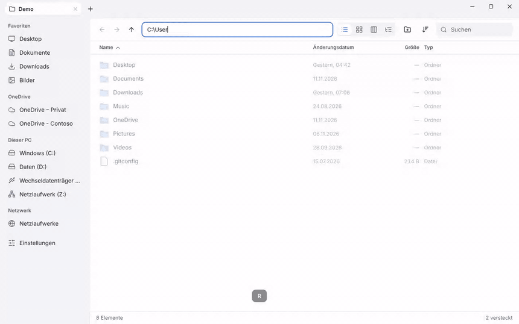<br><sub><b>Ansichten:</b> Liste, Kacheln, Spalten mit Vorschau, Baum</sub></td>
<td width="50%">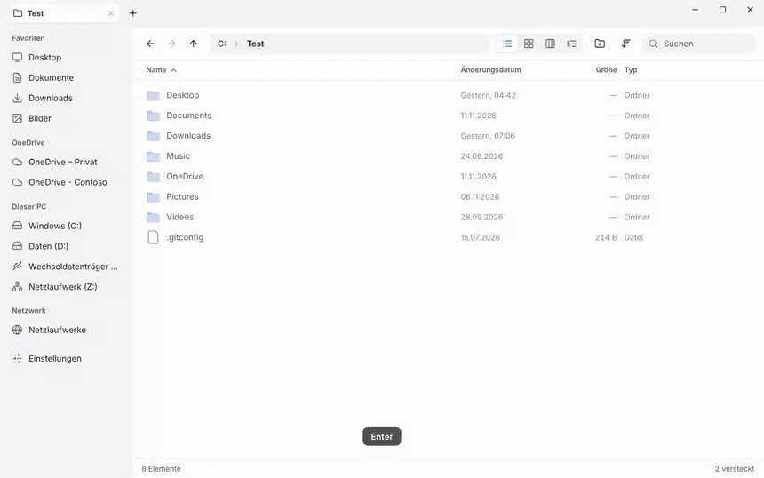<br><sub><b>Suche:</b> Unterordner, Platzhalter, Tippsuche</sub></td>
</tr>
<tr>
<td>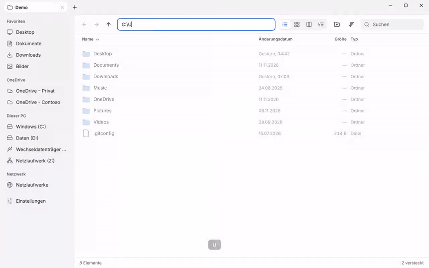<br><sub><b>Auswahl &amp; Ziehen:</b> Gummiband, Drag &amp; Drop, Gruppieren</sub></td>
<td>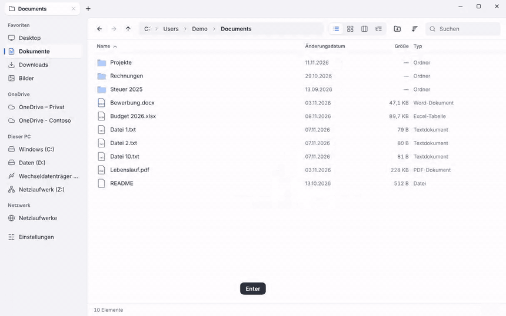<br><sub><b>Menü &amp; Favoriten:</b> anheften, umsortieren, dunkles Design</sub></td>
</tr>
</table>

### Weitere Einblicke

<table>
<tr>
<td width="33%">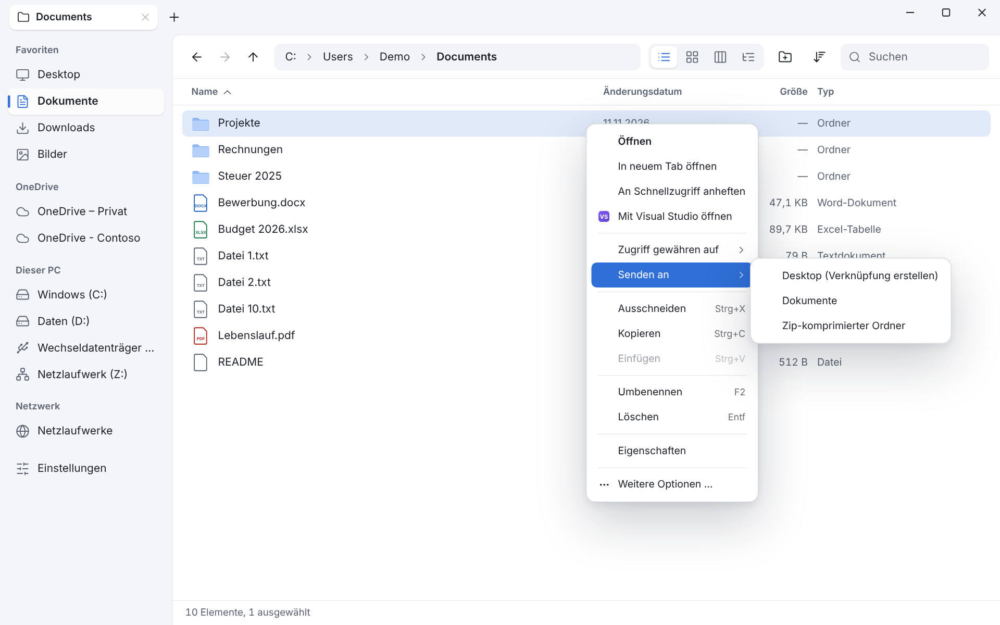<br><sub>Kontextmenü mit Untermenüs</sub></td>
<td width="33%">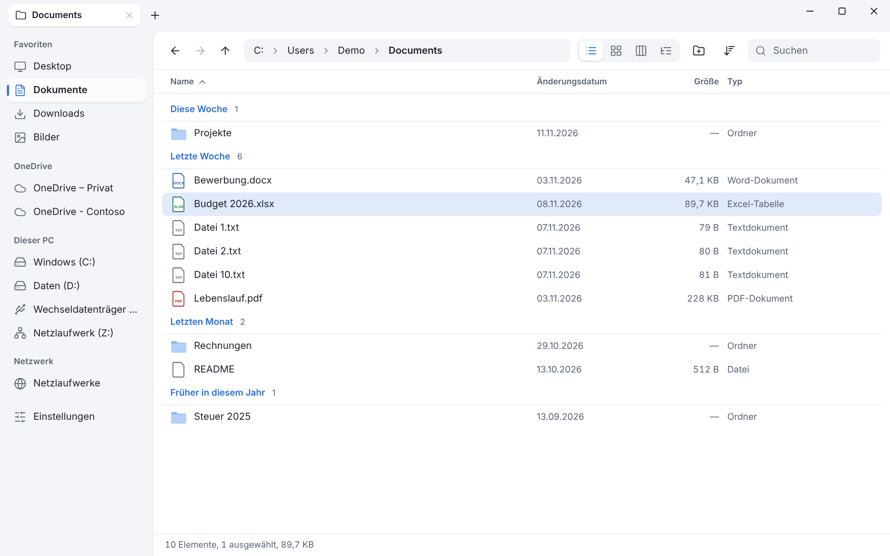<br><sub>Gruppiert nach Änderungsdatum</sub></td>
<td width="33%">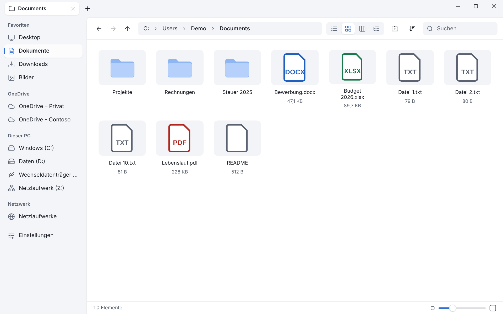<br><sub>Kachelansicht</sub></td>
</tr>
<tr>
<td>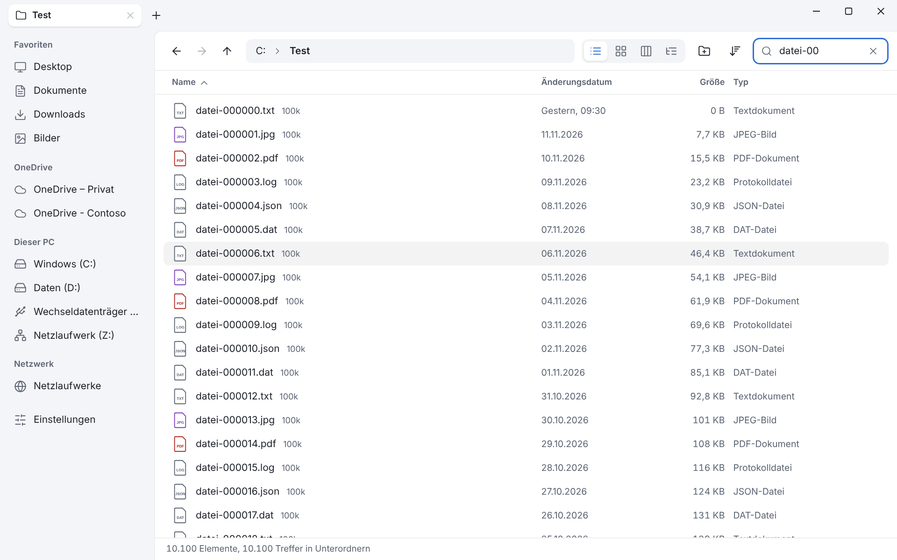<br><sub>Treffer aus Unterordnern</sub></td>
<td>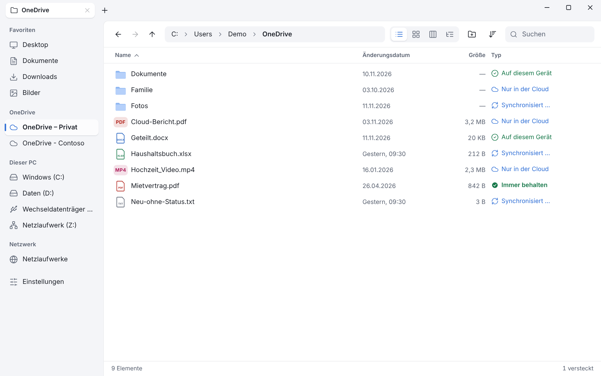<br><sub>OneDrive-Status</sub></td>
<td>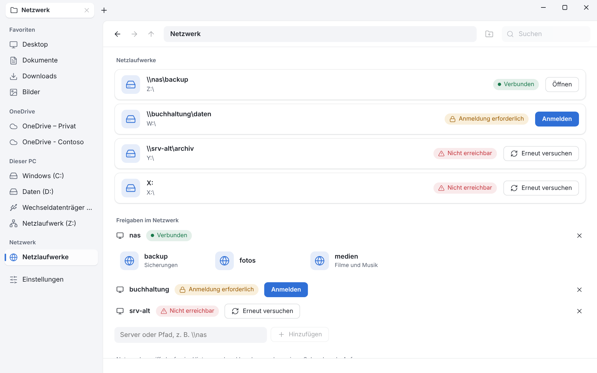<br><sub>Netzlaufwerke</sub></td>
</tr>
<tr>
<td>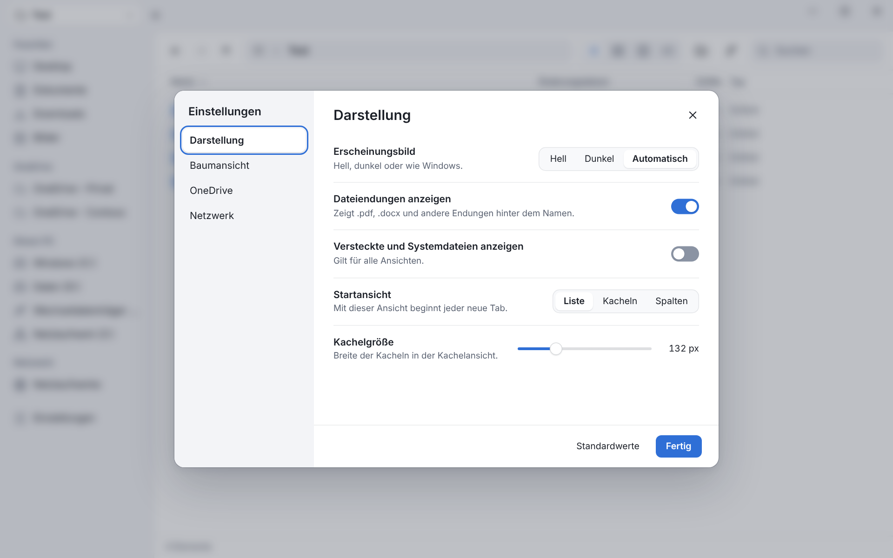<br><sub>Einstellungen</sub></td>
<td>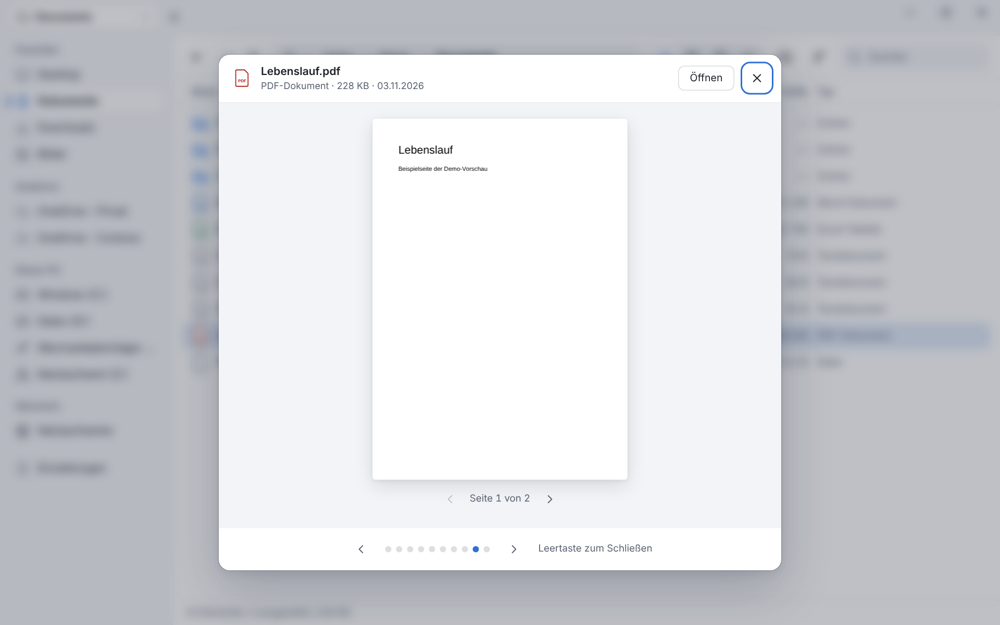<br><sub>Schnellvorschau (PDF)</sub></td>
<td>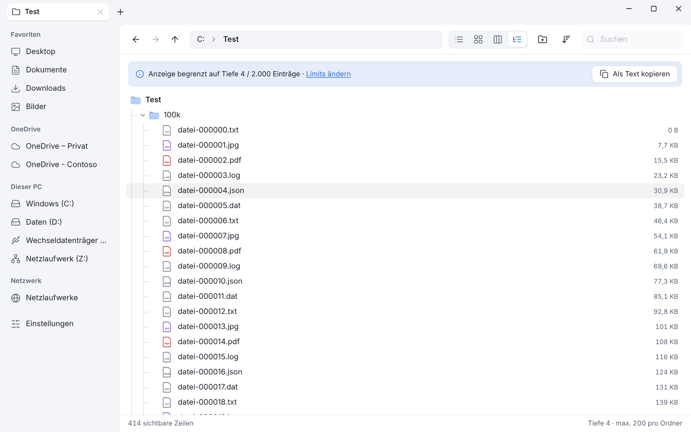<br><sub>Baumansicht mit Limits</sub></td>
</tr>
</table>

## Installieren

1. Lade vom [neuesten Release](https://github.com/theslasher5g/eX-plorer/releases/latest) eine der Dateien:
   - **`eX-plorer_…_x64-setup.exe`** – installiert **pro Benutzer**, ohne Administratorrechte *(empfohlen)*
   - **`eX-plorer_…_x64_de-DE.msi`** – systemweit, fragt nach Administratorrechten
2. Prüfe bei Bedarf die Summe mit `SHA256SUMS.txt` (`Get-FileHash <Datei>` in PowerShell).
3. Starten und loslegen. Die WebView2-Laufzeit (unter Windows 11 vorhanden) wird bei Bedarf nachgeladen.

> [!WARNING]
> Die Installer sind **nicht signiert**. Windows SmartScreen zeigt deshalb ggf. „Der
> Computer wurde durch Windows geschützt“ – über *Weitere Informationen → Trotzdem ausführen*
> geht es weiter. Wer dem nicht traut, baut die App [selbst](#selbst-bauen).

**Voraussetzungen:** Windows 10 (ab 1809) oder Windows 11, x64.

## Bedienung

| Aktion | Eingabe |
| --- | --- |
| Ansicht wechseln | `Strg+1` Liste · `Strg+2` Kacheln · `Strg+3` Spalten · `Strg+4` Baum |
| Suchen (auch Unterordner) | `Strg+F`, dann tippen – `*` und `?` sind Platzhalter |
| Datei anspringen | Erste Buchstaben des Namens tippen |
| Schnellvorschau | `Leertaste` |
| Pfad eingeben | `Strg+L` oder `F4` |
| Zurück / Vor / Hoch | `Alt+←` / `Alt+→` / `Alt+↑` (oder Maustasten 4/5, Rücktaste) |
| Neuer / geschlossener Tab, wechseln | `Strg+T` / `Strg+W` / `Strg+Tab` |
| Kopieren, Ausschneiden, Einfügen | `Strg+C` / `Strg+X` / `Strg+V` (auch mit dem Windows-Explorer) |
| Umbenennen, Löschen | `F2` · `Entf` (Papierkorb), `Umschalt+Entf` (endgültig) |
| Neuer Ordner | `Strg+Umschalt+N` |
| Kontextmenü | Rechtsklick, `Menütaste` oder `Umschalt+F10` |
| Favoriten anheften | Rechtsklick auf einen Ordner bzw. auf die leere Fläche |
| Mehrere Dateien wählen | Mit der Maus auf freier Fläche ziehen (`Strg`/`Umschalt` behalten die Auswahl) |
| Einstellungen | `Strg+,` |

Alle Abläufe, Grenzen und Hinweise stehen im [Handbuch](docs/HANDBUCH.md#bedienung).

## Selbst bauen

Voraussetzungen: [Rust](https://rustup.rs) (stable, MSVC-Toolchain, „Desktopentwicklung mit C++“ aus den
Visual-Studio-Build-Tools), [Node.js](https://nodejs.org) 22 oder neuer, Windows 10/11.

```bash
git clone https://github.com/theslasher5g/eX-plorer.git
cd eX-plorer
npm install
npm run tauri dev        # Entwicklungsmodus mit Hot-Reload
npm run tauri build      # Installer (NSIS + MSI) unter src-tauri/target/release/bundle/
```

Nur die Oberfläche im Browser, mit erfundenen Demo-Daten und ohne Zugriff aufs Dateisystem
(auch unter Linux/macOS nützlich):

```bash
npm run dev
```

Prüfungen (laufen genauso in der CI auf `windows-latest`):

```bash
npm run check
cd src-tauri
cargo fmt --all --check
cargo clippy --workspace --all-targets -- -D warnings
cargo test --workspace
cargo audit
```

## Aufbau

```
src/                    Svelte 5 + TypeScript (Oberfläche, Stores, Demo-Backend)
src-tauri/
  crates/core/          Plattformneutraler Kern: Pfadprüfung, Listing, Suche, Baum, Einstellungen …
  src/                  Tauri-App: Commands und dünne Windows-Schicht (Shell, COM, Registry, WNet)
docs/                   Handbuch, Medien
```

Das Frontend hat **keinen** Dateisystemzugriff; es spricht nur mit eigenen, validierenden
Tauri-Commands. Der Kern ist ohne Windows testbar (`cargo test -p explorer-core`), die
Windows-Aufrufe stehen in kleinen, abgegrenzten Modulen. Mehr im [Handbuch](docs/HANDBUCH.md#aufbau).

## Sicherheit

- **Minimale Rechte:** keine Tauri-Plugins für Dateisystem oder Shell, Capabilities nur für Fenstersteuerung.
- **Jeder Pfad wird im Backend geprüft** – Traversal, Junctions, reservierte Namen, Alternate Data Streams, lange Pfade.
- **Strikte CSP**, keine Remote-Inhalte, kein `eval`, Dateinamen nie als HTML.
- **Nichts wird automatisch geöffnet oder ausgeführt**; Programme (exe, bat, ps1 …) nur nach Bestätigung.
- **Nur Metadaten beim Auflisten:** OneDrive-Platzhalter werden nie gelesen, Netzwerkpfade haben Zeitlimits.
- `unsafe` nur in kleinen Windows-Modulen, `unwrap()` per Lint verboten, `clippy -D warnings` und `cargo audit` in der CI.

Eine Schwachstelle gefunden? Bitte **privat** melden – siehe [SECURITY.md](SECURITY.md).

## Mitmachen

Fehler melden, Ideen einbringen, Code beisteuern – siehe [CONTRIBUTING.md](CONTRIBUTING.md).
Neue Versionen veröffentlichst du mit `npm run version:set -- x.y.z`, einem Eintrag im
[CHANGELOG](CHANGELOG.md) und einem Tag `vx.y.z` (der [Release-Workflow](.github/workflows/release.yml) baut und veröffentlicht).

## Danksagung

Gebaut mit [Tauri](https://tauri.app), [Svelte](https://svelte.dev), [pdf.js](https://mozilla.github.io/pdf.js/),
[Lucide](https://lucide.dev) und dem [`windows`-Crate](https://github.com/microsoft/windows-rs).
Das Aussehen folgt dem Design „Lichtung“.

## Lizenz

[MIT](LICENSE) © 2026 theslasher5g
